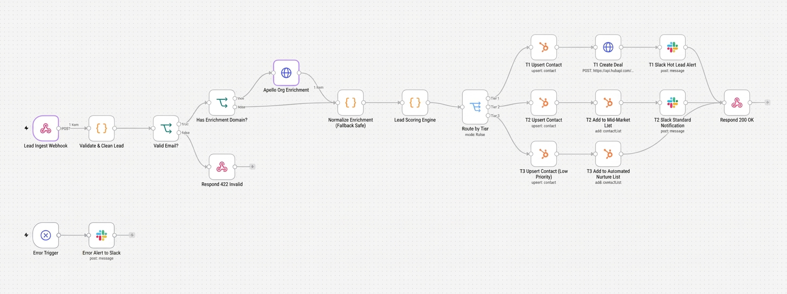

# Multi-Source Lead Enrichment & Routing Pipeline (n8n)

An automated, event-driven lead ingestion, enrichment, scoring, and routing engine built in n8n. This pipeline ingests incoming inbound leads via Webhook, validates data schemas, enriches company profiles using Apollo API, scores leads through a dynamic decision engine, and routes them to HubSpot CRM and Slack channels based on target buyer criteria.



## 🚀 Key Features

- **Real-Time Webhook Ingestion:** Accepts structured inbound JSON payloads from forms or outbound tools.
- **Strict Payload Validation:** Enforces clean data checks prior to downstream API operations.
- **Apollo Data Enrichment:** Dynamically fetches organization metrics (employee headcount, revenue range, industry, tech stack).
- **Custom Scoring Engine:** Computes a composite lead score based on target company size, domain fit, and job title seniority.
- **Tiered Lead Routing:**
  - **Tier 1 (Hot Leads / Enterprise):** Immediate HubSpot Contact & Deal upsert + instant Slack notification to sales channels.
  - **Tier 2 (Mid-Market):** HubSpot Contact upsert + standard SDR task assignment.
  - **Tier 3 (Low Score / Self-Serve):** Automated nurturing sequence enrollment / light CRM log.
- **Resilient Error Handling:** Configured with isolated node error handling and fallback routines for reliable deployment.

---

## 🛠️ Tech Stack & Integrations

| Component | Technology | Description |
|---|---|---|
| **Orchestration** | n8n (Self-Hosted Docker) | Workflow automation platform hosted on VPS |
| **Enrichment** | Apollo API | Firmographic data enrichment |
| **CRM** | HubSpot Sales Cloud | Contact upserts, deal creation, and SDR task assignments |
| **Notifications** | Slack Webhooks / Bot API | Hot lead alerts for sales response teams |

---

## 📂 Repository Layout

- `workflows/`: Exported n8n workflow JSON ready for import.
- `test-payloads/`: Sample JSON test vectors for Tier 1, Tier 2, and Tier 3 evaluation.
- `docs/`: System architecture documentation and logic maps.

---

## ⚡ Quick Start (Importing into n8n)

1. **Clone the repository:**
   ```bash
   git clone [https://github.com/dhrobinsystems/n8n-lead-enrichment-pipeline.git](https://github.com/dhrobinsystems/n8n-lead-enrichment-pipeline.git)
   cd n8n-lead-enrichment-pipeline
---

## ⚠️ Disclaimer

This project, including all associated workflows, scripts, and documentation, is provided "as is" without warranty of any kind, express or implied. The author and contributors assume no responsibility or liability for any errors, omissions, or operational disruptions resulting from the use of these automation tools, CRM integrations, or third-party API verification calls. Always test and audit configurations thoroughly in a staging environment prior to production deployment.

---
